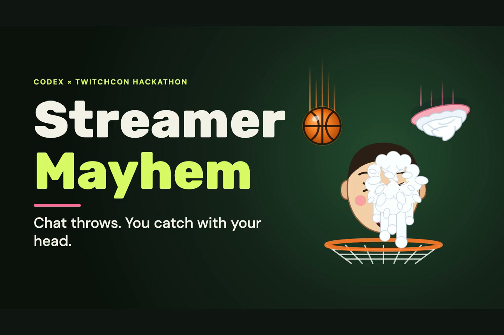
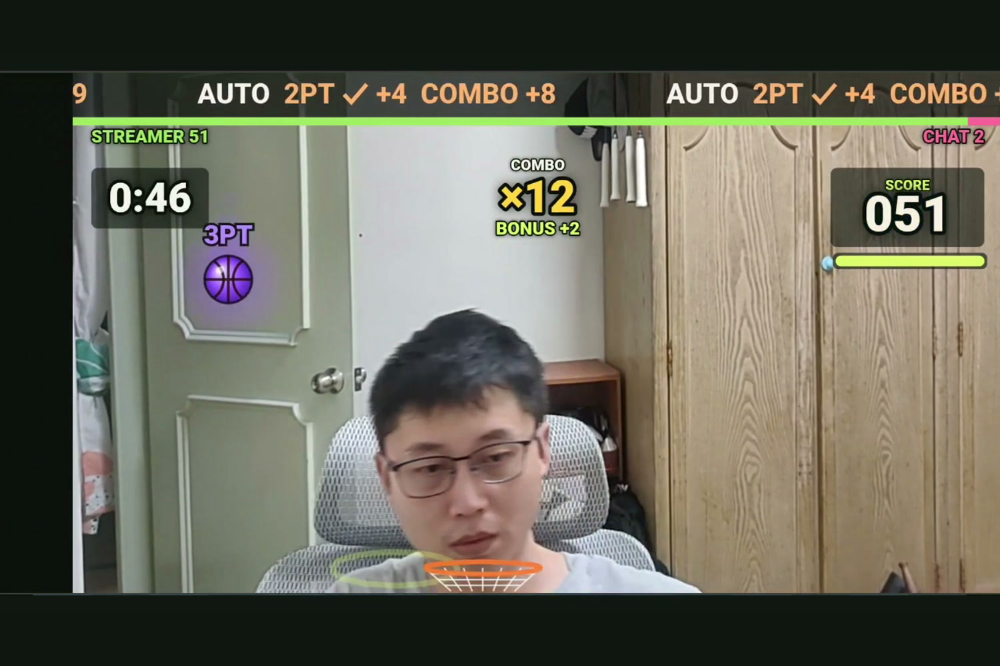
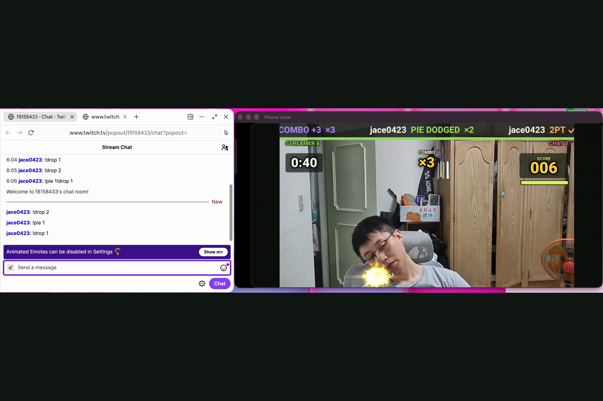
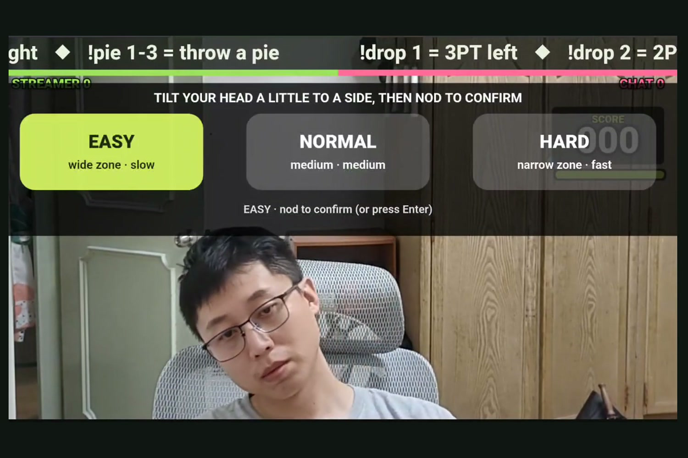
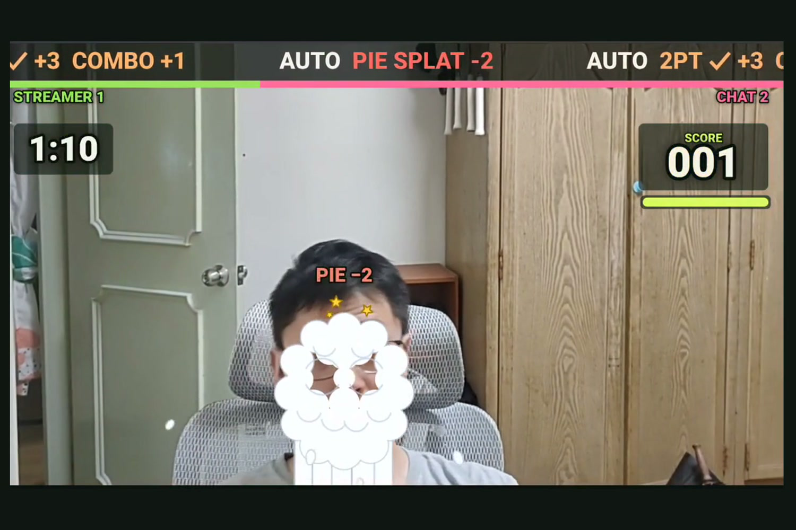
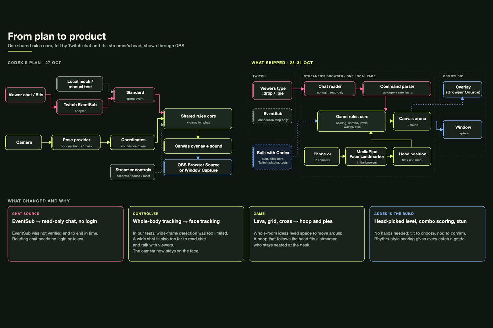
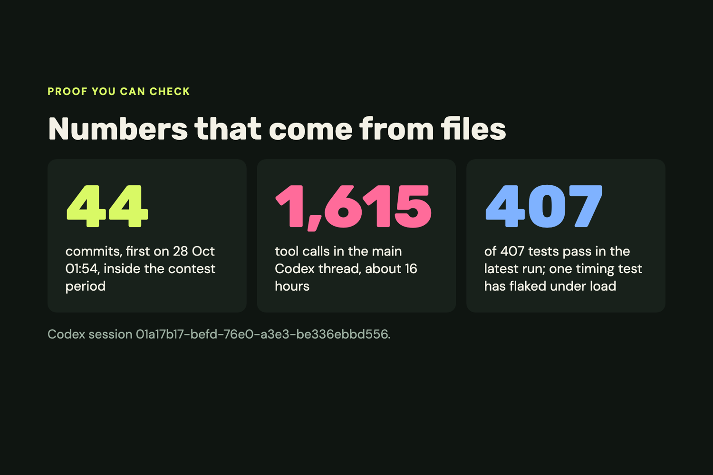
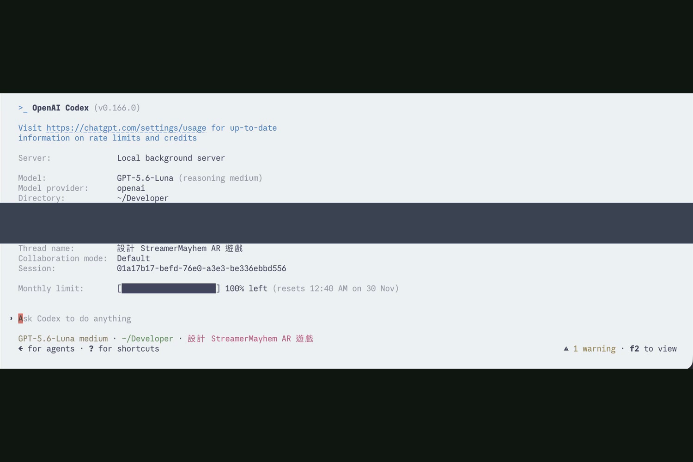

# StreamerMayhem

A Twitch interactive game for a seated streamer, themed as basketball. Chat shoots balls and throws pies. The streamer leans their head to move a hoop under their face, catching the balls and dodging the pies. A face model running in the browser tab tracks the head; keyboard or mouse is the fallback. Viewers type commands. The streamer sees the shots on the game page, and a subset of them on a transparent OBS Browser Source overlay. Built for the Codex x TwitchCon Hackathon.

**Who it is for:** a streamer sitting at a computer with the face camera as the main picture (Just Chatting style), streaming with OBS in landscape. Outdoor and phone-only streaming is out of scope, because those apps have no place for a browser-source overlay. A phone can serve as the camera (see below).

## What it does

- **Basketball (the main game).** Viewers send `!drop 1-3` for a ball and `!pie 1-3` for a pie (`!bomb` still works as an alias). The middle lane (`!drop 2`) is a two-pointer dropped from above. The left and right lanes are three-pointers thrown in an arc from that side. A hoop about one face width wide follows the streamer's head along the bottom. Covering the ball when it lands scores: the closer to the ball's middle the better (PERFECT +1, GOOD −1), and a streak of catches adds up to +3 per catch. A pie flashes a warning column first. A pie that lands on the hoop costs the streamer 2 points and gives chat 2; dodging scores nothing. Only the left/right position counts. If the face is not tracked, the result is UNKNOWN, never a guess.
- **Modes and head menu.** Open `/` for practice. **Auto drops** sends irregular waves of balls and pies over a 75 s round, then shows a grade (S from 130 points, A from 95, B from 60 on NORMAL; each level has its own thresholds). Open `/live` for chat-only play: no automatic waves, only viewers' commands. A link on the page switches between the two. The streamer can pick the level with the head: tilt to choose, nod to confirm.
- **Chat on screen.** A top marquee strip scrolls the latest results with the viewer's name (for example a three-pointer, a pie splat, a dodge). A streamer-versus-chat bar sits under it. When a chat message carries Bits, the strip shows the viewer's name with a star, and a star ball carrying that name is sent; catching it triggers a thank-you. A star next to a name also marks subscribers. Reading names aloud with the browser voice is off by default. The announcer voice clips are generated locally with Kokoro (see `dist/voice/NOTICE.md`).
- **Extra legacy modes** (kept in the simulator and rules core, outside the basketball theme):
  - The 3x3 `!throw 1-9` mode is still in the rules core and its tests. The game page turns it off for chat, because it would bypass the ball and pie scoring.
  - Cross Inferno: cells 2/4/5/6/8 are hit after a 1.5 s warning; corners 1/3/7/9 are safe.
  - Freeze (`!freeze`): keep five joints inside a narrow box through a yellow then red phase.
  - Lava (`!lava`): rising lava over 8 s.
- **Fairness.** One result per event. Duplicate message IDs are dropped for commands, users are rate-limited, and the queue is bounded. When tracking is lost, the result is UNKNOWN (no damage, no score).
- **OBS overlay.** A transparent OBS Browser Source page (not a Twitch Extension) receives game state over a local relay. It draws a subset of the game page on top of the streamer's camera, not everything the game page shows.
- **Twitch connection.** Two paths feed the same game rules.
  1. Login-free: the page reads a public channel's chat over Twitch's IRC WebSocket without a login (`dist/irc_anonymous.mjs`). It is read-only, needs no account or Twitch application, and never sends messages. Twitch does not document reading chat without a login, so this path could stop working; EventSub is Twitch's supported route. Use it only on your own channel or one whose owner agreed. It has a join timeout, a 6 minute idle limit and endless reconnect.
  2. OAuth implicit grant plus an EventSub WebSocket `channel.chat.message` subscription, with reconnect, keepalive watchdog and revocation handling. The token stays in page memory, is never written to disk or logs, and expires (re-authorize then).

  Chat and names are handled in memory only. Not affiliated with or endorsed by Twitch.

## Screenshots

Frames from the demo video (https://youtu.be/x7fBKSyv6oE). The game footage is a local recording, not a live broadcast; the chat window is real Twitch chat typed from a second account, shown next to a separate recording of the game (the two are not frame-synchronised).

| | |
|---|---|
|  |  |
|  |  |
|  |  |
|  |  |

## No webcam?

**Start playing** needs a camera: without one it returns to its idle state with a camera message and does not start a round. To try the game with keyboard and mouse:

1. Open **More options**, then **More options (practice mode, OAuth, test tools)**, then **Practice without chat (audience simulator)** (three collapsed sections).
2. Tick **Auto drops** to run a round of balls and pies, or type `!drop 2` or `!pie 1` in the command box and press the arrow button.
3. Move the hoop by clicking or dragging in the arena, or click the arena and use the arrow keys (the arrow buttons under the arena also work).
4. To try the supporter features, type `Cheer100 !drop 2` (a simulated cheer of 100 Bits with a drop).

## Requirements

Node.js with the built-in `node:test` runner (tested with v26.12.1; the test command uses `--test-force-exit`, so use a recent Node). No packages to install. A modern browser. OBS is optional.

## Run

```sh
node scripts/serve-local.mjs
```

Open `http://127.0.0.1:4173/`. Without any Twitch setup the page runs in clearly labeled `SIMULATED` mode: use the audience simulator under **More options** (see "No webcam?" above) and type `!drop 2` or `!pie 1`.

To connect to real Twitch, follow [TWITCH_LIVE_SETUP.md](TWITCH_LIVE_SETUP.md). Quickest path: in **Connect to Twitch chat without login**, type a channel name and press Connect.

## Test

```sh
node --test --test-force-exit tests/*.test.mjs
```

The suite reports 407 tests; on 31 Oct all 407 passed in a run where loopback listening was permitted (inside a sandbox the 2 `serve_local` tests fail with `EPERM` because they cannot bind `127.0.0.1`). Tests use fake clocks, synthetic event IDs and generated landmarks. One timing test (`obs_resource_guard`) can fail when the machine is busy.

## Limits

- Camera tracking: press **Start playing** (or **Turn on camera tracking** under More options). The page runs Google's MediaPipe (Apache-2.0, bundled under `dist/vendor/mediapipe/`, see its NOTICE.md and LICENSE-Apache-2.0.txt) on your camera, locally. The default Face Landmarker follows your head. The game frames you automatically (about six face widths across, face a little above the middle) and mirrors the picture. Tracking loss never scores or hurts (the result is UNKNOWN). Body mode (pose) is for the older Freeze and Lava modes. Models load under the page's security policy, and mapping and framing are unit tested. Keep the camera fixed and sit alone in view. The model library tries to send a usage-log request to Google; the page's Content-Security-Policy blocks it, so nothing leaves the machine. Without the camera, input is synthetic (keyboard or mouse).
- Seated play: **Auto-frame** (a checkbox, on by default) crops the picture around your face (about six face widths wide) and re-frames only if you move much closer or farther. The camera image is **mirrored** by default, so leaning left moves left. Face tracking uses MediaPipe Face Landmarker, which keeps tracking a tilted head; the plain face detector is the fallback. Open the page with `?debug=1` for a readout (face score, frames per second, position, judged position).
- Camera measurement: one Android phone (rear camera, glasses), on an earlier straight-drop version of the game, not the current basketball build. Face tracking ran at about 22 frames per second, three of three drops were caught, and catch judging matched the head position (for example head at 41%/64%/50% for targets 35%/65%/50%). This is a single-person, single-device check, not a study; accuracy depends on lighting and camera placement.
- Twitch chat: tested against the local protocol simulator and the Twitch CLI mock. The login-free IRC path connected to a real channel and received its room id. Real chat commands typed from a second Twitch account on a real channel triggered balls and pies in the demo video (the game footage there is a local recording, not a live broadcast). Unit tests with a fake socket also cover its message parsing. The EventSub path reached the connection stage only. Chat delivery through EventSub has not been tested live and needs the streamer's own Twitch app.
- Bits and supporter features (star balls, star on the marquee) were tested with simulated cheers only. Whether a real Bits message arrives through the IRC `bits` tag is untested.
- OBS: the overlay was tested in a synthetic Browser Source profile only, not in OBS itself, and shows a subset of the game page.

## Third-party assets
- MediaPipe Tasks Vision and models (Apache-2.0): `dist/vendor/mediapipe/`, see its `NOTICE.md` for sources and checksums.
- Three sparkle sprites from the Kenney Particle Pack by Kenney (https://kenney.nl/), license CC0 (public domain; credit is optional and given here): `dist/vendor/kenney-particles/`, with the license file and checksums in its `NOTICE.md`. They draw the catch burst effect.
- StreamerMayhem's own code is released under the MIT License (see `LICENSE`). Third-party parts keep their own licenses, listed above and in `dist/voice/NOTICE.md`.
- Announcer voice clips (`dist/voice/`): generated locally with Kokoro-82M (Apache-2.0), see `dist/voice/NOTICE.md`.

## Layout

| Path | Purpose |
|---|---|
| `dist/` | Static game, overlay and Twitch provider (no build step) |
| `scripts/` | Local server, overlay relay, OBS test runner |
| `tests/` | Node test suite and fixtures |
| `docs/ENGINEERING_NOTES.md` | Historical engineering notes and evidence trail, written before the basketball theme (some parts describe the old 3x3 game) |

## Built with Codex

The main OpenAI Codex thread (about 16 hours and 1,615 tool calls; session ID in [SUBMISSION.md](SUBMISSION.md)) produced the plan and the first version of the game: the shared rules core, the Twitch provider and EventSub adapter, the overlay protocol and a first suite of about 170 tests. That work is this repository's first commit. The basketball game on top of it (login-free chat, camera tracking, drop waves, sound, difficulty and head menu) was built afterwards with Claude Code, 28–31 Oct. See [SUBMISSION.md](SUBMISSION.md).
